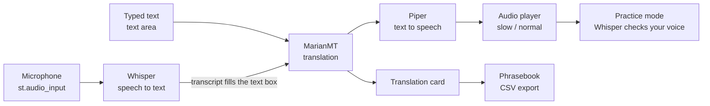
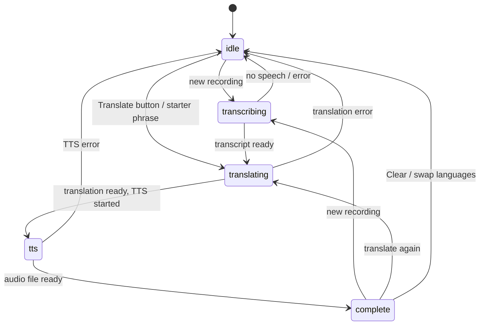

# linguaflow-speech-translation

A local AI speech translation pipeline for English ↔ French using Whisper STT, MarianMT translation, and Piper TTS, built with Streamlit.

Speak or type a phrase, read the translation, hear it spoken back, then practise saying it yourself. LinguaFlow is designed for language learners: it gives you slow playback, pronunciation feedback and a phrasebook you can export as flashcards.

---

## Table of contents

1. [Features](#features)
2. [How it works (overview)](#how-it-works-overview)
3. [Project structure](#project-structure)
4. [Setup and run](#setup-and-run)
5. [The pipeline in detail](#the-pipeline-in-detail)
6. [How the Streamlit app is built](#how-the-streamlit-app-is-built)
7. [Learning features in detail](#learning-features-in-detail)
8. [Module reference](#module-reference)
9. [Styling](#styling)
10. [Configuration and customisation](#configuration-and-customisation)
11. [Adding a new language](#adding-a-new-language)
12. [Deployment](#deployment)
13. [Troubleshooting](#troubleshooting)
14. [Limitations](#limitations)
15. [Tech stack](#tech-stack)

---

## Features

- **Speak or type**: record with your microphone or type text in either language.
- **Three-stage AI pipeline**: Whisper (speech to text) → MarianMT (translation) → Piper (text to speech).
- **Editable transcript**: what Whisper heard appears in the text box so you can fix mistakes and translate again.
- **Slow playback**: replay the translated audio at 0.6×, 0.8× or normal speed.
- **Practice mode**: repeat the phrase and get a word-by-word match score.
- **Starter phrases**: one-tap everyday phrases.
- **Phrasebook**: save translations during the session and export them as CSV flashcards.
- **Swap languages**: flip direction and use the translation as the next input.
- **Open-source models**: no external translation or speech APIs.

---

## How it works (overview)



There are two entry points (voice and text) that meet at the translation step:

1. **Voice**: a recording is saved to a WAV file, Whisper transcribes it in the language you chose, and the transcript is placed in the text box.
2. **Text**: whatever is in the text box is used directly.
3. MarianMT translates the text.
4. Piper generates speech for the translation in a background thread, so the translated text appears on screen before the audio is ready.
5. When the audio finishes, an audio player with speed buttons appears, along with save, download and practice options.

---

## Project structure

```
translation/
├── app.py                  # Streamlit app: UI, state machine, learning features
├── requirements.txt
├── styles/
│   └── style.css           # Dark theme injected into Streamlit
├── src/
│   ├── speech_to_text.py   # Whisper wrapper
│   ├── translator.py       # MarianMT wrapper
│   └── text_to_speech.py   # Piper wrapper
├── models/
│   └── voices/             # Piper voice files (.onnx + .onnx.json)
├── audio/                  # Temporary per-session audio files (auto-cleaned)
└── .streamlit/
    └── config.toml         # Theme settings
```

---

## Setup and run

### Requirements

- Python 3.10 or newer
- [ffmpeg](https://ffmpeg.org/) (Whisper needs it to read audio)
- Streamlit 1.39 or newer
- One Piper voice per language

### Install

```bash
git clone <your-repo-url>
cd translation

python -m venv .venv
source .venv/bin/activate        # Windows: .venv\Scripts\activate

pip install -r requirements.txt
```

Install ffmpeg:

```bash
brew install ffmpeg              # macOS
sudo apt install ffmpeg          # Ubuntu/Debian
```

### Piper voices

Download an English and a French voice from the
[Piper voices repository](https://huggingface.co/rhasspy/piper-voices).
Put each `.onnx` file and its matching `.onnx.json` file into `models/voices/`.

### Theme

Create `.streamlit/config.toml`:

```toml
[theme]
base = "dark"
```

### Run

```bash
streamlit run app.py
```

The first launch downloads the Whisper and MarianMT models, so expect a delay. Later launches load from cache.

---

## The pipeline in detail

### Stage 0: input

- **Recording**: `st.audio_input` returns the recorded audio. The app computes an MD5 hash of the bytes and compares it with `last_audio_hash`. Only a new hash starts processing, because Streamlit re-runs the script constantly and the same recording would otherwise be processed again on every run.
- **Typing**: the **Translate** button copies the text box content into `transcript` and moves the pipeline to the translating stage. Empty input shows a message instead.
- **Starter phrases**: these fill the text box and start translation the same way.

### Stage 1: speech to text (Whisper)

- Runs only when `pipeline_stage == "transcribing"`.
- Calls `SpeechToText.transcribe(audio_path, language_code)`.
- The source language is **set explicitly** from the "I speak" dropdown. Whisper does not guess the language, which avoids mistakes on short phrases and keeps results consistent.
- Whisper decodes with `temperature=0` for deterministic output, `condition_on_previous_text=False` to avoid repetition loops, and `without_timestamps=True` for speed.
- An empty transcript returns the app to idle with a "No speech detected" message.
- On success, the transcript is stored and the stage moves to `translating`.

### Stage 2: translation (MarianMT)

- Runs when `pipeline_stage == "translating"`.
- Calls `Translator.translate(text, source_code, target_code)`.
- If source and target languages are the same, the text is passed through unchanged.
- Once the translation exists, the app starts TTS and moves to the `tts` stage, then re-runs so the translated text is visible immediately.

### Stage 3: text to speech (Piper)

- Piper generation runs in a `ThreadPoolExecutor(max_workers=1)` so the UI stays responsive.
- The TTS model is loaded in the main script thread (via `st.cache_resource`) and passed into the worker, because Streamlit's cache is not reliable from worker threads.
- A fragment, `monitor_tts`, polls every 0.5 seconds. When the future finishes, it stores the audio path and timing, sets the stage to `complete`, and triggers a full re-run so the player appears.

### Pipeline state machine



The current stage lives in `st.session_state.pipeline_stage`. Inputs and buttons are disabled while the stage is `transcribing`, `translating` or `tts`, which prevents overlapping runs.

---

## How the Streamlit app is built

Streamlit re-executes `app.py` from top to bottom on every interaction. Several patterns in the app exist because of that.

| Pattern | Why it exists |
|---|---|
| `st.session_state` holds all state | Variables reset on each re-run; session state survives. |
| `st.cache_resource` on model loaders | Whisper, MarianMT and Piper load once per server process and are shared across sessions. |
| `on_click` callbacks | Callbacks run *before* the re-run, so they can safely change widget values (for example, the text box or dropdowns). |
| `pending_input_text` | A widget's value can't be changed after it is drawn in the same run. The transcript is stored here, then applied at the top of the next run, before the text box is created. |
| `st.rerun()` after stage changes | Shows intermediate results (transcript, translation) before the next slow step starts. |
| Progress steps rendered *before* heavy work | The "Listen / Translate / Generate voice" indicator is drawn first, so it is visible while the model runs. |
| Per-session file names | Each visitor gets a unique ID, and audio files are named `<id>_input.wav`, `<id>_output.wav`, `<id>_practice.wav`. Visitors can't overwrite each other's audio. |
| Old-file cleanup | At the start of a session, WAV files older than one hour are deleted. |

### Session state keys

| Key | Purpose |
|---|---|
| `pipeline_stage` | `idle`, `transcribing`, `translating`, `tts` or `complete` |
| `transcript` | The source text that was translated |
| `translation` | The translated text |
| `input_text` | Content of the editable text box |
| `pending_input_text` | Transcript waiting to be pushed into the text box |
| `source_language_select`, `target_language_select` | The dropdown values |
| `tts_future` | The background TTS job |
| `audio_path` | Path of the generated speech file |
| `last_audio_hash` | Hash of the last processed recording |
| `phrasebook` | Saved phrases for this session |
| `practice_n`, `practice_hash`, `practice_result` | Practice-mode state |
| `stt_time`, `translation_time`, `tts_time` | Timing for the performance panel |
| `sid` | Unique session ID used in file names |

---

## Learning features in detail

### Slow playback

Streamlit's built-in `st.audio` has no speed control, so the app embeds a small HTML audio player (`components.html`). The generated WAV is base64-encoded into the page, and the buttons set `playbackRate` to 0.6, 0.8 or 1.0 with `preservesPitch` on, so slower speech stays natural.

### Practice mode

1. After a translation is ready, open **Practice saying it**.
2. Record yourself saying the translated phrase.
3. The recording is transcribed by Whisper in the **target** language.
4. The expected translation and your transcript are split into lowercase words and compared with Python's `difflib.SequenceMatcher`.
5. The score is `matched words ÷ expected words × 100`.
6. Expected words are shown in green when matched and in orange when missing or different, and the app shows what Whisper heard.

Because the check goes through speech recognition, the score reflects how clearly Whisper understood you. It is a useful guide, not a phonetic grader. Accents are not scored separately, and accented letters count as part of a word (so "ete" and "été" differ).

### Phrasebook

- **Save to phrasebook** stores the source text, translation and language pair.
- **Reuse** reloads a saved phrase with its languages set.
- **Export as flashcards (CSV)** produces a `Front,Back` file that Anki and Quizlet can import.
- Phrases live in the browser session only. A refresh or closed tab clears them.

### Starter phrases

A short list per language (see `STARTERS` in `app.py`). They show in the source language and translate on click.

---

## Module reference

The app depends on three small classes in `src/`. Their expected interfaces, as used by `app.py`:

```python
# src/speech_to_text.py
class SpeechToText:
    def __init__(self, model_size: str = "base"): ...
    def transcribe(self, audio_path: str, language: str) -> tuple[str, str]:
        """Return (transcript, language_code)."""

# src/translator.py
class Translator:
    def translate(self, text: str, source: str, target: str) -> str:
        """Translate text between language codes such as 'en' and 'fr'."""

# src/text_to_speech.py
class TextToSpeech:
    def __init__(self, voice_directory: str): ...
    def generate_audio(self, text: str, language: str, output_path: str) -> str:
        """Write a WAV file and return its path."""
```

**Device selection**: `SpeechToText` uses CUDA when available and the CPU otherwise. It deliberately avoids Apple's MPS backend, because Whisper's alignment buffer uses a sparse tensor that MPS does not support.

---

## Styling

`styles/style.css` is read by `app.py` and injected with `st.markdown(..., unsafe_allow_html=True)`.

- **Design tokens**: colours are CSS variables in `:root` (`--bg`, `--surface`, `--accent`, `--good`, `--bad`, and so on). Change them in one place to retheme the app.
- **Typography**: Fraunces for the logo and score, Inter for everything else, loaded from Google Fonts.
- **Components**: classes such as `.card`, `.steps`, `.step`, `.score`, `.w-ok`, `.w-bad` and `.phrase` match the HTML emitted by `app.py`.
- **Streamlit overrides**: selects, text areas, buttons, alerts, audio input, metrics and expanders are restyled to fit the theme.
- **Starter chips**: styled through the `.st-key-chips` class, generated by `st.container(key="chips")`.
- **Responsive and accessible**: a mobile breakpoint at 768px, visible focus outlines on buttons, and `prefers-reduced-motion` support.

Streamlit's internal class names can change between versions. After upgrading Streamlit, check the UI for broken styling.

---

## Configuration and customisation

| What | Where |
|---|---|
| Whisper model size (`tiny`, `base`, `small`, ...) | `load_stt()` in `app.py` |
| Languages, flags, starter phrases | `LANGUAGES`, `FLAGS`, `STARTERS` in `app.py` |
| Colours and fonts | `:root` variables and `@import` in `style.css` |
| Cleanup age for audio files | The `3600` seconds check near the top of `app.py` |
| Playback speeds | Button list in `audio_player()` in `app.py` |
| Piper voices | Files in `models/voices/` |

Larger Whisper models are more accurate, especially for accents, but they are slower and need more memory. `base` is a good balance for short phrases.

---

## Adding a new language

1. **Whisper** already supports it. Add its code (for example `"es"`).
2. **MarianMT**: make sure `Translator` can load a model pair for it (for example Helsinki-NLP `opus-mt` models for the direction you need). Some language pairs need a model in each direction.
3. **Piper**: add a voice for that language to `models/voices/` and make sure `TextToSpeech` can find it from the language code.
4. **App**: add the language to `LANGUAGES`, `FLAGS` and `STARTERS` in `app.py`.

---

## Deployment

- **Files**: audio is written to the `audio/` folder under unique per-session names and cleaned up automatically. The server needs write access to that folder.
- **Models**: include your Piper voices in the build. Whisper and MarianMT download on first use, so use a persistent disk or bake them into your image to avoid slow cold starts.
- **Memory**: Whisper Base plus MarianMT needs roughly 2 GB of RAM. Treat this as an estimate and measure on your instance.
- **CPU vs GPU**: everything runs on CPU. A CUDA GPU is used automatically for Whisper if present.
- **Concurrency**: models are shared across visitors. Heavy simultaneous use will queue, so for many users run more than one instance.
- **HTTPS is required for the microphone**: browsers block microphone access on plain HTTP outside `localhost`.
- **Phrasebook**: stored in session state only. Add a database for accounts or persistence.
- **System packages**: install ffmpeg on the server (for example in your Dockerfile or `packages.txt`).

---

## Troubleshooting

**`NotImplementedError ... SparseMPS` when loading Whisper (Apple Silicon)**
Whisper can't run on the MPS backend. In `src/speech_to_text.py`:

```python
@staticmethod
def _get_device():
    return "cuda" if torch.cuda.is_available() else "cpu"
```

Then fully stop Streamlit, delete `__pycache__` folders, and restart:

```bash
find . -name "__pycache__" -type d -exec rm -rf {} +
streamlit run app.py
```

**The error still shows the old code**
Streamlit may keep old modules imported. Stop the server with `Ctrl+C` and restart it. Pressing `C` in the app and choosing "Clear cache" also clears the cached models.

**`ffmpeg` not found**
Install ffmpeg and restart your terminal.

**No speech detected**
Allow microphone access in your browser, speak closer to the mic, and check that the "I speak" language matches what you say.

**No audio after translation**
Confirm the Piper `.onnx` and `.onnx.json` files for the target language are in `models/voices/`.

**Microphone button is missing or disabled on a deployed site**
The site must be served over HTTPS.

**Broken layout after a Streamlit upgrade**
Selectors in `style.css` target Streamlit internals. Re-check them against the new version.

---

## Limitations

- English ↔ French only until more language pairs are added.
- Practice scoring is based on speech recognition output, not phonetic analysis.
- Translation quality is that of MarianMT. It is good for everyday phrases and weaker on idioms and long text.
- Phrasebook data is not saved between sessions.
- Whisper Base can struggle with strong accents, noise and very short audio.

---

## Tech stack

| Component | Tool |
|---|---|
| UI | Streamlit |
| Speech to text | OpenAI Whisper (Base) |
| Translation | MarianMT (Hugging Face Transformers) |
| Text to speech | Piper |
| Audio and ML runtime | PyTorch, ffmpeg |

## License

This project is licensed under the MIT License. See the LICENSE file for details.