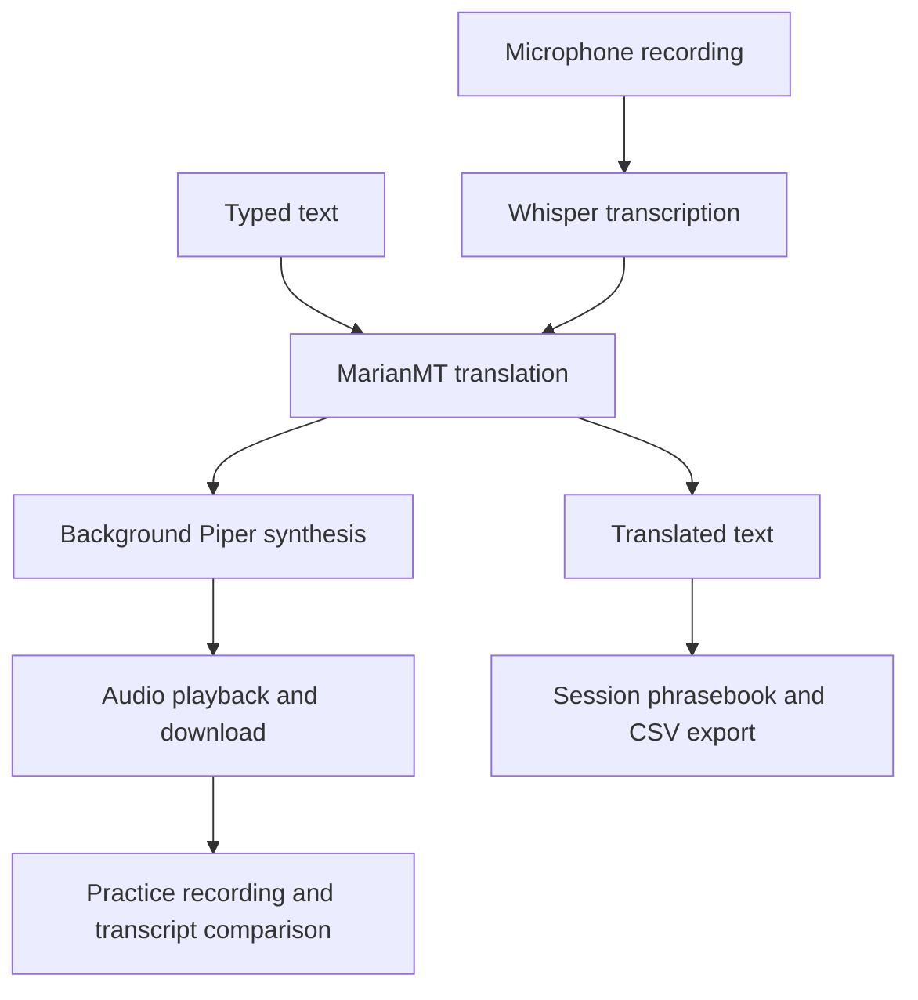
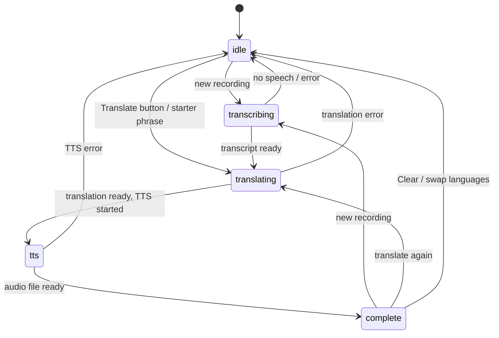

# LinguaFlow — English–French Speech Translation

A local AI speech translation pipeline for English ↔ French using Whisper STT, MarianMT translation, and Piper TTS, built with Streamlit.

Speak or type a phrase, read the translation, hear it spoken back, then practise saying it yourself. LinguaFlow is designed for language learners: it gives you slow playback, transcript-based practice feedback and a phrasebook you can export as flashcards.

**[Live demo](https://linguaflow-speech-translation.streamlit.app/)** · **[View code](https://github.com/aathiabhishek/linguaflow-speech-translation)**

> **Where inference runs:** Models execute on the machine hosting the app. Local use runs on your computer; the hosted demo processes recordings on its server. Model downloads require internet, but inference does not use external translation or speech APIs.

---

## Table of contents

1. [Features](#features)
2. [How it works (overview)](#how-it-works-overview)
3. [Project structure](#project-structure)
4. [Setup and run](#setup-and-run)
5. [The pipeline in detail](#the-pipeline-in-detail)
6. [How the Streamlit app is built](#how-the-streamlit-app-is-built)
7. [Learning features in detail](#learning-features-in-detail)
8. [Module reference](#module-reference)
9. [Styling](#styling)
10. [Configuration and customisation](#configuration-and-customisation)
11. [Adding a new language](#adding-a-new-language)
12. [Deployment](#deployment)
13. [Troubleshooting](#troubleshooting)
14. [Limitations](#limitations)
15. [Evaluation and model comparison](#evaluation-and-model-comparison)
16. [Tests](#tests)
17. [Tech stack](#tech-stack)
18. [License](#license)

---

## Features

- **Speak or type**: record with your microphone or type text in either language.
- **Three-stage AI pipeline**: Whisper (speech to text) → MarianMT (translation) → Piper (text to speech).
- **Editable transcript**: what Whisper heard appears in the text box so you can fix mistakes and translate again.
- **Slow playback**: replay the translated audio at 0.6×, 0.8× or normal speed.
- **Practice mode**: repeat the phrase and get a word-by-word match score.
- **Starter phrases**: one-tap everyday phrases.
- **Phrasebook**: save translations during the session and export them as CSV flashcards.
- **Swap languages**: flip direction and use the translation as the next input.
- **Local model inference**: no external translation or speech inference APIs.
- **Measured model comparison**: MarianMT is the selected backend; M2M100 remains available for experiments.
- **Long-input handling**: token-aware segmentation avoids silently discarding text beyond the input limit.

---

## How it works (overview)



There are two entry points (voice and text) that meet at the translation step:

1. **Voice**: a recording is saved to a WAV file, Whisper transcribes it in the language you chose, and the transcript is placed in the text box.
2. **Text**: whatever is in the text box is used directly.
3. MarianMT translates the text.
4. Piper generates speech for the translation in a background thread, so the translated text appears on screen before the audio is ready.
5. When the audio finishes, an audio player with speed buttons appears, along with save, download and practice options.

---

## Project structure

```text
translation/
├── app.py                       # UI, state machine and learning tools
├── requirements.txt
├── packages.txt                 # FFmpeg for hosted deployment
├── evaluate.py                  # Single-pass evaluation CLI
├── src.txt                      # English evaluation sentences
├── ref.txt                      # Aligned French sentences
├── styles/
│   └── style.css
├── src/
│   ├── speech_to_text.py         # Whisper wrapper
│   ├── translator.py             # MarianMT / M2M100 backends
│   ├── text_to_speech.py         # Piper wrapper
│   ├── text_utils.py             # Token-aware splitting and language validation
│   └── evaluation_utils.py       # Evaluation file checks
├── scripts/
│   ├── download_models.py
│   └── check_ui.py               # UI smoke check using simulated models
├── tests/
│   └── test_regressions.py
├── models/                      # Local assets, excluded from source control
│   ├── voices/                  # Piper .onnx + .onnx.json pairs
│   └── m2m100_418M/              # Optional comparison model
├── audio/                       # Temporary per-session recordings and speech
├── evaluation_results/          # Generated results, one directory per run
├── historical/                  # Earlier predictions
└── .streamlit/
    └── config.toml
```

---

## Setup and run

### Requirements

- Python 3.11 or 3.12 recommended
- [ffmpeg](https://ffmpeg.org/) (Whisper needs it to read audio)
- Streamlit 1.66 or newer, below 2.0, as specified in `requirements.txt`
- One Piper voice per language

### Install

Activate the Python environment you already use for LinguaFlow, then run:

```bash
git clone https://github.com/aathiabhishek/linguaflow-speech-translation.git
cd linguaflow-speech-translation
python -m pip install -r requirements.txt
```

If the project is already downloaded, open its existing directory instead of cloning it again.

Install ffmpeg:

```bash
brew install ffmpeg              # macOS
sudo apt install ffmpeg          # Ubuntu/Debian
```

### Piper voices

Download an English and a French voice from the
[Piper voices repository](https://huggingface.co/rhasspy/piper-voices).
Put each `.onnx` file and its matching `.onnx.json` file into `models/voices/`.

### Theme

Create `.streamlit/config.toml`:

```toml
[theme]
base = "dark"
```

### Run

```bash
TRANSLATION_BACKEND=marian python -m streamlit run app.py
```

The first use of each stage downloads missing model assets, so expect a delay. Later uses load cached files.

MarianMT is the selected default after comparison. To make plain `python -m streamlit run app.py` use MarianMT, the fallback in `src/translator.py` should be:

```python
self.backend = backend or os.getenv("TRANSLATION_BACKEND", "marian")
```

The explicit launch command above selects MarianMT even if you still have the earlier M2M100 default. Restart Streamlit after changing backend settings.

---

## The pipeline in detail

### Stage 0: input

- **Recording**: `st.audio_input` returns the recorded audio. The app computes an MD5 hash of the bytes and compares it with `last_audio_hash`. Only a new hash starts processing, because Streamlit re-runs the script constantly and the same recording would otherwise be processed again on every run.
- **Typing**: the **Translate** button copies the text box content into `transcript` and moves the pipeline to the translating stage. Empty input shows a message instead.
- **Starter phrases**: these fill the text box and start translation the same way.

### Stage 1: speech to text (Whisper)

- Runs only when `pipeline_stage == "transcribing"`.
- Calls `SpeechToText.transcribe(audio_path, language_code)`.
- The source language is **set explicitly** from the "I speak" dropdown. Whisper does not guess the language, which avoids mistakes on short phrases and keeps results consistent.
- Whisper uses `temperature=0`, `condition_on_previous_text=False`, and `without_timestamps=True`. These settings reduce sampling variability and dependence on previous text; they do not guarantee error-free transcription.
- An empty transcript returns the app to idle with a "No speech detected" message.
- On success, the transcript is stored and the stage moves to `translating`.

### Stage 2: translation (MarianMT)

- Runs when `pipeline_stage == "translating"`.
- Calls `Translator.translate(text, source_code, target_code)`.
- If source and target languages are the same, the text is passed through unchanged.
- MarianMT uses separate `Helsinki-NLP/opus-mt-en-fr` and `Helsinki-NLP/opus-mt-fr-en` models, loaded when needed.
- Generation uses one beam with sampling disabled by default.
- Short inputs are preserved. Long inputs are split at sentence boundaries, with word-based fallback and tokenizer checks for oversized sentences. Segmentation may lose paragraph formatting or cross-sentence context.
- CUDA, MPS, or CPU is selected for translation, depending on availability or configuration.
- M2M100 is an optional alternative, using explicit source-language and target-token control.
- Once the translation exists, the app starts TTS and moves to the `tts` stage, then re-runs so the translated text is visible immediately.

### Stage 3: text to speech (Piper)

- Piper generation runs through a shared `ThreadPoolExecutor(max_workers=2)`, keeping background worker count bounded across sessions.
- The cached TTS engine is obtained on the main script thread and passed into the worker. Voices are loaded lazily by that engine.
- Both the voice model and configuration are checked. Missing-voice downloads have a timeout.
- Audio is written to a temporary WAV, validated, and atomically moved to the final path. Shared model use is protected by locks.
- A fragment, `monitor_tts`, polls every 0.5 seconds. When the future finishes, it stores the audio path and timing, sets the stage to `complete`, and triggers a full re-run so the player appears.

### Pipeline state machine



The current stage lives in `st.session_state.pipeline_stage`. Language selectors, swap, recorder, translation controls, and phrase reuse are disabled while the stage is `transcribing`, `translating` or `tts`, preventing conflicting requests within a session.

---

## How the Streamlit app is built

Streamlit re-executes `app.py` from top to bottom on every interaction. Several patterns in the app exist because of that.

| Pattern                                     | Why it exists                                                                                                                                                                |
| ------------------------------------------- | ---------------------------------------------------------------------------------------------------------------------------------------------------------------------------- |
| `st.session_state` holds all state          | Variables reset on each re-run; session state survives.                                                                                                                      |
| `st.cache_resource` on model loaders        | Whisper, MarianMT and Piper load once per server process and are shared across sessions.                                                                                     |
| `on_click` callbacks                        | Callbacks run _before_ the re-run, so they can safely change widget values (for example, the text box or dropdowns).                                                         |
| `pending_input_text`                        | A widget's value can't be changed after it is drawn in the same run. The transcript is stored here, then applied at the top of the next run, before the text box is created. |
| `st.rerun()` after stage changes            | Shows intermediate results (transcript, translation) before the next slow step starts.                                                                                       |
| Progress steps rendered _before_ heavy work | The "Listen / Translate / Generate voice" indicator is drawn first, so it is visible while the model runs.                                                                   |
| Per-session file names                      | Each visitor gets a unique ID, and audio files are named `<id>_input.wav`, `<id>_output.wav`, `<id>_practice.wav`. Visitors can't overwrite each other's audio.              |
| Old-file cleanup                            | At the start of a session, WAV files older than one hour are deleted.                                                                                                        |

### Session state keys

| Key                                                | Purpose                                                    |
| -------------------------------------------------- | ---------------------------------------------------------- |
| `pipeline_stage`                                   | `idle`, `transcribing`, `translating`, `tts` or `complete` |
| `transcript`                                       | The source text that was translated                        |
| `translation`                                      | The translated text                                        |
| `input_text`                                       | Content of the editable text box                           |
| `pending_input_text`                               | Transcript waiting to be pushed into the text box          |
| `source_language_select`, `target_language_select` | The dropdown values                                        |
| `tts_future`                                       | The background TTS job                                     |
| `audio_path`                                       | Path of the generated speech file                          |
| `last_audio_hash`                                  | Hash of the last processed recording                       |
| `phrasebook`                                       | Saved phrases for this session                             |
| `practice_n`, `practice_hash`, `practice_result`   | Practice-mode state                                        |
| `stt_time`, `translation_time`, `tts_time`         | Timing for the performance panel                           |
| `sid`                                              | Unique session ID used in file names                       |

---

## Learning features in detail

### Slow playback

Streamlit's built-in `st.audio` has no speed control, so the app embeds a small HTML audio player (`st.iframe`). The generated WAV is base64-encoded into the page, and the buttons set `playbackRate` to 0.6, 0.8 or 1.0 with `preservesPitch` on, so slower speech stays natural.

### Practice mode

1. After a translation is ready, open **Practice saying it**.
2. Record yourself saying the translated phrase.
3. The recording is transcribed by Whisper in the **target** language.
4. The expected translation and your transcript are split into lowercase words and compared with Python's `difflib.SequenceMatcher`.
5. The score is `matched words ÷ expected words × 100`.
6. Expected words are shown in green when matched and in orange when missing or different, and the app shows what Whisper heard.

Because the check goes through speech recognition, the score measures overlap between the expected words and Whisper’s transcript. Recognition errors can affect the score. It is a useful guide, not a phonetic grader. Accents are not scored separately, and accented letters count as part of a word (so "ete" and "été" differ).

### Phrasebook

- **Save to phrasebook** stores the source text, translation and language pair.
- **Reuse** reloads a saved phrase with its languages set.
- **Export as flashcards (CSV)** produces a `Front,Back` file that Anki and Quizlet can import.
- Phrases live in the browser session only. A refresh or closed tab clears them.

### Starter phrases

A short list per language (see `STARTERS` in `app.py`). They show in the source language and translate on click.

---

## Module reference

The app depends on three small classes in `src/`. Their expected interfaces, as used by `app.py`:

```python
# src/speech_to_text.py
class SpeechToText:
    def __init__(self, model_size: str = "base"): ...
    def transcribe(self, audio_path: str, language: str) -> tuple[str, str]:
        """Return (transcript, language_code)."""

# src/translator.py
class Translator:
    def __init__(self, model_path=None, backend=None, num_beams=None,
                 device=None, local_files_only=None): ...
    def translate(self, text: str, source: str, target: str) -> str:
        """Translate text between language codes such as 'en' and 'fr'."""

# src/text_to_speech.py
class TextToSpeech:
    def __init__(self, voice_directory: str): ...
    def generate_audio(self, text: str, language: str, output_path: str) -> str:
        """Write a WAV file and return its path."""
```

**Device selection**: `SpeechToText` uses CUDA when available and the CPU otherwise. It deliberately avoids Apple's MPS backend, because Whisper's alignment buffer uses a sparse tensor that MPS does not support.

---

## Styling

`styles/style.css` is read by `app.py` and injected with `st.markdown(..., unsafe_allow_html=True)`.

- **Design tokens**: colours are CSS variables in `:root` (`--bg`, `--surface`, `--accent`, `--good`, `--bad`, and so on). Change them in one place to retheme the app.
- **Typography**: Fraunces for the logo and score, Inter for everything else, loaded from Google Fonts.
- **Components**: classes such as `.card`, `.steps`, `.step`, `.score`, `.w-ok`, `.w-bad` and `.phrase` match the HTML emitted by `app.py`.
- **Streamlit overrides**: selects, text areas, buttons, alerts, audio input, metrics and expanders are restyled to fit the theme.
- **Starter chips**: styled through the `.st-key-chips` class, generated by `st.container(key="chips")`.
- **Responsive and accessible**: a mobile breakpoint at 768px, visible focus outlines on buttons, and `prefers-reduced-motion` support.

Streamlit's internal class names can change between versions. After upgrading Streamlit, check the UI for broken styling.

---

## Configuration and customisation

| What                                              | Where                                                |
| ------------------------------------------------- | ---------------------------------------------------- |
| Whisper model size (`tiny`, `base`, `small`, ...) | `WHISPER_MODEL` environment variable; default `base` |
| Translation backend                               | `TRANSLATION_BACKEND=marian` or `m2m100`             |
| Translation device                                | `TRANSLATION_DEVICE=auto`, `cpu`, `mps`, or `cuda`   |
| Beam count                                        | `TRANSLATION_BEAMS`; default `1`                     |
| Local M2M100 folder                               | `TRANSLATION_MODEL_PATH`                             |
| Languages, flags, starter phrases                 | `LANGUAGES`, `FLAGS`, `STARTERS` in `app.py`         |
| Colours and fonts                                 | `:root` variables and `@import` in `style.css`       |
| Cleanup age for audio files                       | The `3600` seconds check near the top of `app.py`    |
| Playback speeds                                   | Button list in `audio_player()` in `app.py`          |
| Piper voices                                      | Files in `models/voices/`                            |

Larger Whisper models may improve transcription on some recordings but require more resources. Compare recognition quality and latency on representative audio before changing from `base`.

---

## Adding a new language

1. **Whisper**: verify that the chosen model supports the language and add its code.
2. **MarianMT**: make sure `Translator` can load a model pair for it (for example Helsinki-NLP `opus-mt` models for the direction you need). Some language pairs need a model in each direction.
3. **Piper**: add a voice for that language to `models/voices/` and make sure `TextToSpeech` can find it from the language code.
4. **Validation and UI**: update `SUPPORTED_LANGUAGES` in `src/text_utils.py`, Piper voice mappings, and `LANGUAGES`, `FLAGS`, and `STARTERS` in `app.py`. The evaluation CLI currently exposes only English–French directions.

---

## Deployment

- **Files**: audio is written to the host’s `audio/` folder under session-specific names. New sessions trigger cleanup of WAV files older than one hour. This is opportunistic cleanup, not immediate deletion when a tab closes. The server needs write access.
- **Models**: include your Piper voices in the build. Whisper and MarianMT download on first use, so use a persistent disk or bake them into your image to avoid slow cold starts.
- **Memory**: measure the combined Whisper, translation, and Piper footprint on the deployment host. M2M100 may require more resources than the MarianMT setup.
- **Devices**: Whisper uses CUDA or CPU. Translation can use CUDA, MPS, or CPU. Piper uses its configured ONNX runtime; the current wrapper does not request CUDA.
- **Concurrency**: model resources are shared, with locks around inference and language-setting changes. Background TTS uses two workers, while its shared engine serializes synthesis. This has not been load-tested for production traffic.
- **HTTPS is required for the microphone**: browsers block microphone access on plain HTTP outside `localhost`.
- **Phrasebook**: stored in session state only. Add a database for accounts or persistence.
- **System packages**: `packages.txt` specifies FFmpeg for Streamlit Community Cloud.
- **Backend configuration**: configure `TRANSLATION_BACKEND=marian` in the server environment; a local shell setting does not configure your hosted app.
- **Privacy**: hosted recordings and text are processed on the server. No external inference API is used, but hosted use is not on-device processing.

---

## Troubleshooting

**`NotImplementedError ... SparseMPS` when loading Whisper (Apple Silicon)**
Whisper can't run on the MPS backend. In `src/speech_to_text.py`:

```python
@staticmethod
def _get_device():
    return "cuda" if torch.cuda.is_available() else "cpu"
```

Then fully stop Streamlit, delete `__pycache__` folders, and restart:

```bash
find . -name "__pycache__" -type d -exec rm -rf {} +
streamlit run app.py
```

**The error still shows the old code**
Streamlit may keep old modules imported. Stop the server with `Ctrl+C` and restart it. Pressing `C` in the app and choosing "Clear cache" also clears the cached models.

**`ffmpeg` not found**
Install ffmpeg and restart your terminal.

**No speech detected**
Allow microphone access in your browser, speak closer to the mic, and check that the "I speak" language matches what you say.

**No audio after translation**
Confirm the Piper `.onnx` and `.onnx.json` files for the target language are in `models/voices/`.

**Microphone button is missing or disabled on a deployed site**
The site must be served over HTTPS.

**Broken layout after a Streamlit upgrade**
Selectors in `style.css` target Streamlit internals. Re-check them against the new version.

---

## Limitations

- English ↔ French only until more language pairs are added.
- Practice scoring is based on speech recognition output, not phonetic analysis.
- Translation quality depends on the selected model, domain, phrasing, and input length. Models can mistranslate names, numbers, idioms, or unsupported content.
- Phrasebook data is not saved between sessions.
- Whisper Base can struggle with strong accents, noise and very short audio.

---

## Evaluation and model comparison

The text translation component was evaluated in **French → English** using the same **500 aligned sentence pairs**, **one beam**, and **sacreBLEU 2.6.0**.

| Model                           |    BLEU ↑ |   chrF2 ↑ | Mean translation time per sentence ↓ |
| ------------------------------- | --------: | --------: | -----------------------------------: |
| **MarianMT — selected backend** | **35.44** | **62.59** |                          **0.430 s** |
| M2M100 418M                     |     29.08 |     58.71 |                              1.027 s |

MarianMT achieved **6.36 more BLEU points** and **3.88 more chrF2 points** in these runs. Its recorded mean time was approximately **58% lower**. Timing comparisons assume the same hardware/device and comparable runtime conditions; confirm those details in each run’s `metrics.json`.

**Decision:** retain MarianMT for the application and keep M2M100 as a comparison backend. These results do not establish superiority for every language, domain, or translation direction.

### What was measured

- `src.txt` contains English; `ref.txt` contains the corresponding French sentences.
- The subset was derived from the first 500 aligned pairs in WMT14 `newstest2014` English-source/French-reference data.
- This experiment reverses those pairs for French → English; it is **not the official direction-specific WMT14 French → English evaluation**.
- BLEU and chrF measure generated-text overlap with reference translations. They are **not translation accuracy percentages**.
- Timings exclude model loading and cover text translation, not Whisper transcription, Piper synthesis, or the complete user interaction.
- These pairs have been used for model/settings comparison; treat them as a development set and reserve unseen data for final evaluation.
- English → French results have not yet been established by these runs.

### Run the evaluation

Start with a small functional check:

```bash
python evaluate.py --backend marian --direction fr-en --n 10
```

Compare both models on the same 500 pairs:

```bash
python evaluate.py --backend marian --direction fr-en --n 500
python evaluate.py --backend m2m100 --direction fr-en --n 500
```

Evaluate the other direction separately:

```bash
python evaluate.py --backend marian --direction en-fr --n 500
```

The evaluator validates line counts and empty sentences, translates each pair **once**, and displays a progress bar. Each run receives a separate folder under `evaluation_results/`, containing:

| Output            | Contents                                                                                                                                |
| ----------------- | --------------------------------------------------------------------------------------------------------------------------------------- |
| `predictions.txt` | The predictions used for scoring, saved as the run progresses.                                                                          |
| `metrics.json`    | BLEU, chrF2, scoring signatures, direction, beams, input hashes, package versions, device, model-loading time, and translation timings. |

Input-file checks cannot prove semantic alignment; inspect corresponding sentence pairs manually. An interrupted run may retain partial predictions but does not produce final metrics.

### Scoring signatures

```text
BLEU:
nrefs:1|case:mixed|eff:no|tok:13a|smooth:exp|version:2.6.0

chrF2:
nrefs:1|case:mixed|eff:yes|nc:6|nw:0|space:no|version:2.6.0
```

The four-beam MarianMT experiment produced **35.46 BLEU**, compared with **35.44** at one beam. This small observed increase does not establish a meaningful quality improvement; one beam remains the selected setting.

---

## Tests

Run lightweight regression checks from the project directory:

```bash
python -m unittest discover -s tests -v
```

The 14 model-free tests cover text splitting, language validation, target-language control, output-limit handling, dataset validation, voice-download checks, and safe WAV output.

Check the Streamlit workflow with simulated models:

```bash
python scripts/check_ui.py
```

This checks rendering, typed input, background audio completion, phrase saving, and language swap. It does not validate actual model quality, microphone capture, or browser audio playback. Model evaluation and a real voice-input smoke test remain separate checks.

---

## Tech stack

| Component            | Tool                                               |
| -------------------- | -------------------------------------------------- |
| UI                   | Streamlit                                          |
| Speech to text       | OpenAI Whisper (Base)                              |
| Translation          | MarianMT selected; M2M100 available for comparison |
| Evaluation           | sacreBLEU 2.6.0, BLEU, chrF2, per-sentence timing  |
| Text to speech       | Piper                                              |
| Audio and ML runtime | PyTorch, ffmpeg                                    |

## License

Application source is licensed under MIT; see `LICENSE`. Dependencies, pretrained models, voice datasets, and evaluation data retain their respective licenses.
